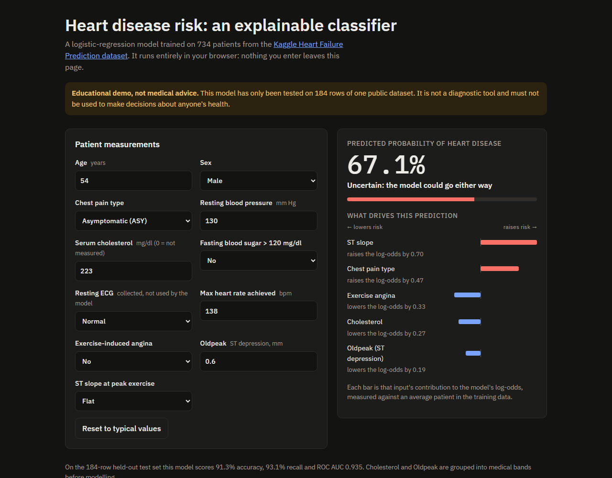
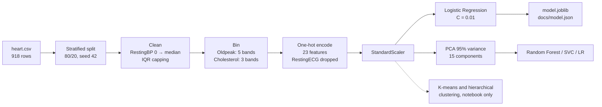
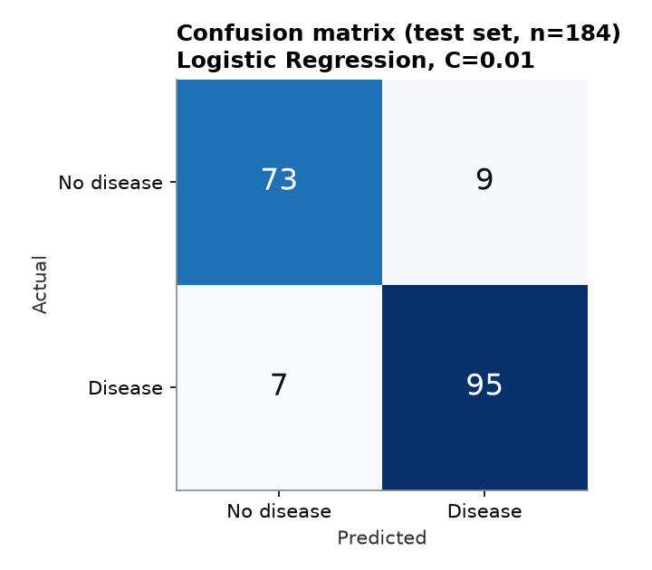
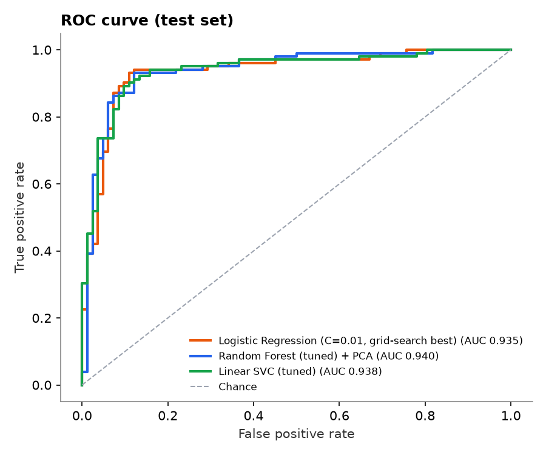
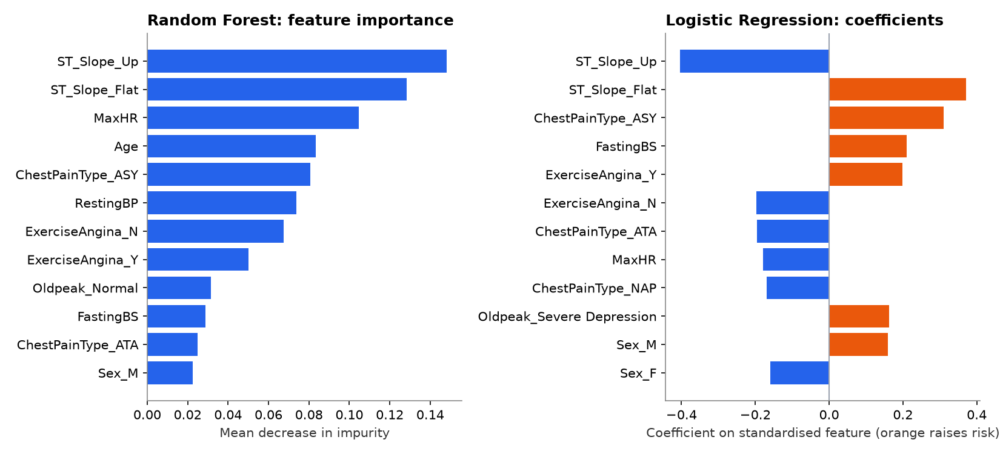
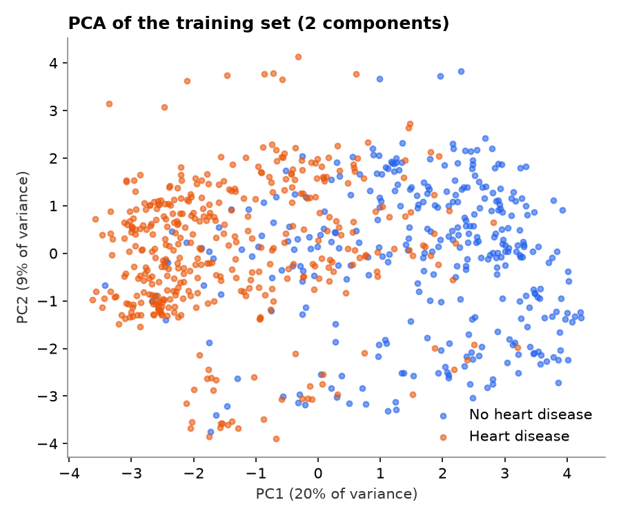

# Heart Failure Prediction: an explainable classifier

End-to-end machine learning on the Kaggle *Heart Failure Prediction* dataset (918 patients, 11 clinical features): cleaning, feature engineering, PCA, clustering, three tuned classifiers, a model card, and a live demo that runs the model in your browser.

**[▶ Live demo](https://nardy11.github.io/Heart_Failure_prediction/)** · [Notebook on nbviewer](https://nbviewer.org/github/Nardy11/Heart_Failure_prediction/blob/main/Heart_Failure_Prediction.ipynb) · [Model card](#model-card)

[](https://nardy11.github.io/Heart_Failure_prediction/)

> **Educational project, not medical advice.** The model was evaluated on 184 rows of one public dataset. It is not a diagnostic tool and must not be used to make decisions about anyone's health.

## Highlights

- **Reproducible:** `train.py` rebuilds the models from `heart.csv` with a fixed seed and writes `model.joblib`, `outputs/metrics.json` and the plots below.
- **Explainable:** the demo shows how much each input pushes the prediction up or down, as contributions to the log-odds.
- **No server:** the logistic regression is exported to JSON and runs client-side. A Node test (`npm test`) checks that the browser and scikit-learn agree on 20 held-out rows to within 1e-9.
- **Honest evaluation:** the numbers below come from re-running the pipeline, and the [limits](#limitations) section lists what they do not show.

## Pipeline



The notebook also covers EDA, chi-square feature selection, QQ-plot scaling choices, K-means (elbow, silhouette, Dunn and Davies-Bouldin indices), hierarchical clustering and decision boundaries.

## Results

Held-out test set: 184 patients (stratified 20%, `random_state=42`). The scores come from `python train.py`; the last column is 5-fold cross-validated F1 on the training split only.

| Model | Accuracy | Precision | Recall | F1 | ROC AUC | Train CV F1 |
|---|---:|---:|---:|---:|---:|---:|
| **Logistic Regression, C=0.01** (deployed) | **91.30%** | 91.35% | **93.14%** | **92.23%** | 0.935 | 0.876 |
| Logistic Regression, C=10 | 89.67% | 91.92% | 89.22% | 90.55% | 0.939 | 0.873 |
| Random Forest (200 trees, depth 10) | 88.04% | 87.74% | 91.18% | 89.42% | 0.934 | 0.876 |
| Linear SVC, C=10 | 89.67% | 91.09% | 90.20% | 90.64% | 0.938 | 0.879 |
| Logistic Regression, C=10 + PCA | 89.67% | 90.29% | 91.18% | 90.73% | 0.939 | 0.871 |
| Random Forest + PCA | 90.22% | 89.62% | 93.14% | 91.35% | **0.940** | 0.870 |
| Linear SVC + PCA | 90.22% | **91.18%** | 91.18% | 91.18% | 0.936 | **0.884** |

**Changes from the earlier version of this table:**

- The earlier table chose *Tuned Random Forest + PCA*. That model is still in the table, with the same scores (90.22% accuracy, 91.35% F1).
- The deployed model is now the logistic regression with **C=0.01**, which is the value the notebook's `GridSearchCV` selected by cross-validation. The notebook's final comparison accidentally re-trained it with C=10. With the C the search actually chose, it has the best test F1 (92.23%) and is fully interpretable.
- All seven models are within about 3 points of each other on a test set of 184 rows. On a set this small, one patient is 0.54 points of accuracy, so the differences are not significant. The Random Forest gives no meaningful gain over the linear model, which is why the demo uses the logistic regression.
- `train.py` fits the cleaning parameters on the training split only. `python train.py --notebook` reproduces the notebook's all-rows fit: the LR and SVC rows then match the notebook exactly, and the Random Forest rows differ by one test patient, most likely because of the scikit-learn version.

<table>
<tr>
<td></td>
<td></td>
</tr>
<tr>
<td colspan="2"></td>
</tr>
<tr>
<td colspan="2"></td>
</tr>
</table>

Both models rely mostly on **ST slope** (a flat slope raises risk, an upsloping one lowers it), **asymptomatic chest pain**, **exercise-induced angina** and **max heart rate**. This agrees with the chi-square ranking in the notebook.

## Model card

| | |
|---|---|
| **Model** | Logistic regression (L2, C=0.01, lbfgs) on 23 standardised features; scikit-learn 1.9. Saved as `model.joblib`; exported as `docs/model.json`. |
| **Task** | Binary classification: `HeartDisease` (1 = heart disease, 0 = normal). |
| **Data** | [Heart Failure Prediction Dataset](https://www.kaggle.com/datasets/fedesoriano/heart-failure-prediction) by fedesoriano (Kaggle, 2021): 918 unique patients merged from five UCI heart disease studies (Cleveland, Hungarian, Switzerland, Long Beach VA, Statlog), collected in the 1980s. 55% positive. Licence: Open Database License (ODbL 1.0) for the database; contents © the original authors. |
| **Inputs** | Age, Sex, ChestPainType, RestingBP, Cholesterol, FastingBS, MaxHR, ExerciseAngina, Oldpeak, ST_Slope. RestingECG is collected but was dropped after the chi-square test. |
| **Evaluation** | Stratified 80/20 split (734 train, 184 test), seed 42. Test metrics are in the [table above](#results). |
| **Intended use** | Learning and portfolio demonstration of a tabular ML workflow and of model explainability. |
| **Out of scope** | Any clinical, screening, triage or insurance decision about a real person. |

### Limitations

- **Small, old and narrow data.** 918 patients from a handful of hospitals, collected decades ago, mostly middle-aged men (median age 54). Patients who had a stress test differ from the general population, so the model's probabilities are not population risk.
- **Model selection used the test set.** The notebook compared models and settings on the same 184-row test set it reports. The best scores are therefore optimistic; a fresh external dataset would very likely give lower ones. The train CV column above is the less biased estimate (about 0.87–0.88 F1).
- **Preprocessing leak in the notebook.** The notebook fitted the outlier caps (IQR) and the RestingBP median on all 918 rows before the split. The leak is small (only MaxHR and RestingBP clipping are affected), and `train.py` fits them on the training split only.
- **Notebook inconsistency.** `GridSearchCV` picked C=0.01 for the logistic regression, but the notebook's final comparison re-trained it with C=10. This repository reports both.
- **Missing values coded as zero.** 172 rows have `Cholesterol = 0`, meaning "not measured". After capping, these fall into the *Normal* cholesterol band, so the model treats "not measured" as normal. Its coefficient for cholesterol is therefore hard to interpret.
- **Probabilities are not calibrated** for any population other than this dataset's 55% prevalence.

### Fairness note: sex and age

`Sex` and `Age` are model inputs. 79% of the patients are men, and the model's coefficient for male sex raises the predicted risk. This reflects the case mix of the source studies, not a validated causal effect. Women are under-represented (193 of 918), so error rates for women rest on far fewer examples. They were not evaluated separately here, and with only 38 women in the test set, a per-group estimate would be very noisy. Any real use would need per-group calibration and error analysis on representative data, and a deliberate decision about whether sex should be an input at all.

## Project structure

```text
Heart_Failure_prediction/
├── Heart_Failure_Prediction.ipynb  # full analysis: EDA, cleaning, PCA, clustering, models, tuning
├── heart.csv                       # dataset (Kaggle, fedesoriano, ODbL)
├── heart_features.py               # cleaning + binning + one-hot encoding, shared by all code
├── train.py                        # reproducible training; writes the files below
├── model.joblib                    # deployed model + cleaning parameters
├── outputs/                        # metrics.json and the plots in this README
├── docs/                           # GitHub Pages demo (index.html, predict.js, model.json)
├── tests/                          # JS vs Python parity test and its 20 reference rows
├── space/                          # Gradio app for a Hugging Face Space
├── requirements.txt
└── package.json                    # npm test
```

## Run it

```bash
python -m venv .venv
source .venv/bin/activate          # Windows: .venv\Scripts\activate
pip install -r requirements.txt

python train.py                    # retrain, rewrite model.joblib, outputs/ and docs/model.json
python train.py --notebook         # reproduce the notebook's preprocessing (prints metrics only)
npm test                           # browser model vs scikit-learn, 20 rows

python -m http.server -d docs 8000 # demo at http://localhost:8000
pip install gradio && python space/app.py   # Gradio version
jupyter notebook Heart_Failure_Prediction.ipynb
```

The notebook is 12 MB (109 plots), so GitHub may not render it; use the [nbviewer link](https://nbviewer.org/github/Nardy11/Heart_Failure_prediction/blob/main/Heart_Failure_Prediction.ipynb).

## Data citation

fedesoriano. (September 2021). *Heart Failure Prediction Dataset.* Retrieved from https://www.kaggle.com/fedesoriano/heart-failure-prediction. Built from the UCI Machine Learning Repository heart disease datasets (creators: Andras Janosi, M.D.; William Steinbrunn, M.D.; Matthias Pfisterer, M.D.; Robert Detrano, M.D., Ph.D.).

## Licence

Code: MIT (see `LICENSE`). Data: ODbL 1.0, see above.
